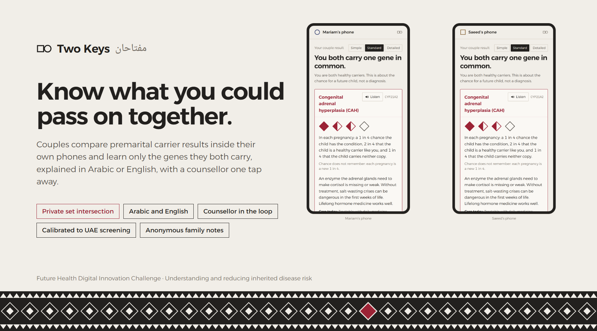

<p align="center"></p>

<p align="center">
  
  
  
  
</p>

**[Live site](https://twokeys-health.vercel.app/en)** · **[Two-phone demo](https://twokeys-health.vercel.app/en/demo)** · **[How it works](https://twokeys-health.vercel.app/en/how)** · **[Proof](https://twokeys-health.vercel.app/en/proof)** · **[Counsellor desk](https://twokeys-health.vercel.app/en/desk)** (demo passcode in the submission) · **[Programme view](https://twokeys-health.vercel.app/en/programme)** · **[Governance](https://twokeys-health.vercel.app/en/governance)** · **[العربية](https://twokeys-health.vercel.app/ar)**

Two Keys lets a couple learn what they could pass on to their children together, and nothing else. Their premarital carrier results are compared inside their own phones with authorised private set intersection: each partner learns only the genes they both carry. Neither learns any other gene the other carries, the families learn nothing, and the relay in between can't read a thing. The lab, which already holds both results, confirms the match and names only the shared genes. Each result is explained in plain Arabic or English at three reading levels, and a counsellor is one tap away. Relatives can be told, anonymously, that they may want a test.

Built for the **Future Health Digital Innovation Challenge** (Abu Dhabi), statement: *Understanding and Reducing Inherited Disease Risk*.

## What's inside

| Part | Where | What it does |
|---|---|---|
| Protocol | `src/lib/psi.ts`, `src/lib/lab.ts` | Authorised PSI (De Cristofaro and Tsudik) with session-bound lab tokens. Diffie–Hellman PSI on ristretto255 over 64-entry padded sets, with a batched Chaum–Pedersen proof on every lock. Role tags make severity-aware matches. A woman's X-linked carrier result reaches her as a personal result |
| Pairing | `src/lib/pairing.ts`, `src/app/api/relay`, `src/app/api/lab` | A link secret in the URL fragment gives the session id, an AES-GCM relay key and three check words. Relay slots are write-once and expire after 10 minutes. Signed identities and atomic seats; the lab recomputes and confirms the match |
| Phone app | `/phone` | Carrier card (couple-only by default; own results on request), pairing, couple result with pedigree icon arrays, three reading levels, Listen, teach-back, options, counsellor booking, explainer, family notes |
| Explainer | `src/lib/ask.ts` | Amazon Nova Pro on Bedrock. Keyword guards and a model intent check run first (partner probing, decide-for-me, crisis in English, Arabic, Gulf dialect and Arabizi). Answers are grounded in vetted facts; code checks reject invented numbers, wrong odds and directive language. Distress offers a same-day counsellor call; anyone can ask a person instead |
| Counsellor desk | `/desk` | Named counsellor accounts, consent-scoped cases, priority clocks (same day, pregnancy, routine), referral and closure, HMAC-keyed audit chain, withdrawal that erases shared data and seals notes |
| Family notes | `/r/[id]` | Letters sealed on the sender's phone. The server stores ciphertext; the relative alone decides whether the sender learns it was read or a test was booked. Senders can take a note back |
| Programme view | `/programme` | Comprehension, uptake, time to referral, cascade testing and equity by language and literacy. One cached release an hour, Laplace noise (ε = 1 per count, budget shown), small-cell suppression; live data and a labelled synthetic month kept apart. It never counts marriages |
| Governance | `/governance` | Clause-by-clause mapping to the DoH Responsible AI Standard, risk tier, model card, data card, DPIA table, risk register, live monitoring counts |
| Evidence | `/proof`, `scripts/` | Unit and end-to-end tests. Pedigree simulator against every published UAE target, with a sensitivity run for unmodelled genes. Explainer evaluation: guards on and off on the same model, 60 development and 48 frozen held-out questions, three judges from other model families |

## Run it

```bash
npm install
npm run dev -- -p 3410        # http://localhost:3410
npm test                      # protocol and risk-engine tests
BASE=http://localhost:3410 npx vitest run tests/pairing.int.test.ts   # two phones over HTTP
npm run calibrate             # data/calibration.json
npm run eval:ask              # data/eval-ask.json (needs AWS Bedrock credentials)
npx tsx --env-file=.env.scripts.local scripts/heldout.mts   # writes eval/heldout.json once, then refuses
```

Environment (`.env.local`):

| Variable | Meaning |
|---|---|
| `LAB_KEY` | 64 hex chars |
| `AWS_REGION`, `AWS_ACCESS_KEY_ID`, `AWS_SECRET_ACCESS_KEY` | Bedrock access |
| `ASK_MODEL` | Default `apac.amazon.nova-pro-v1:0` |
| `STORE_TABLE` | DynamoDB table; without it, memory is used |
| `DESK_PASSCODE` | Counsellor desk passcode |

## Data and rights

- No real person's data is used: every person, result and case is synthetic.
- Carrier frequencies come from published Emirati exomes (Jain et al., *Genet Med Open* 2025), cited, and from gnomAD v4.1 (CC0).
- Variant classes come from ClinVar. Condition explanations link to MedlinePlus Genetics.
- The full table is on `/proof`.

## Limits

- The protocol has not been independently audited. In the single-lab setting it trusts the lab, which already holds both results; private matching matters most when partners are tested by different labs.
- Gene-level matching: where the exact pair of variants matters (non-classic CAH, alpha-globin, HbS/HbC, SMN1), the result says a counsellor will confirm.
- The explainer is graded by models, not yet by a clinician, and its facts await sign-off by a licensed genetic counsellor.
- The demo runs in Sydney on synthetic data. Production needs UAE hosting, a DoH licence (Decree-Law 49/2023 Art. 28) and a National Genomic Database feed (Art. 26).

The details are on `/proof`.
